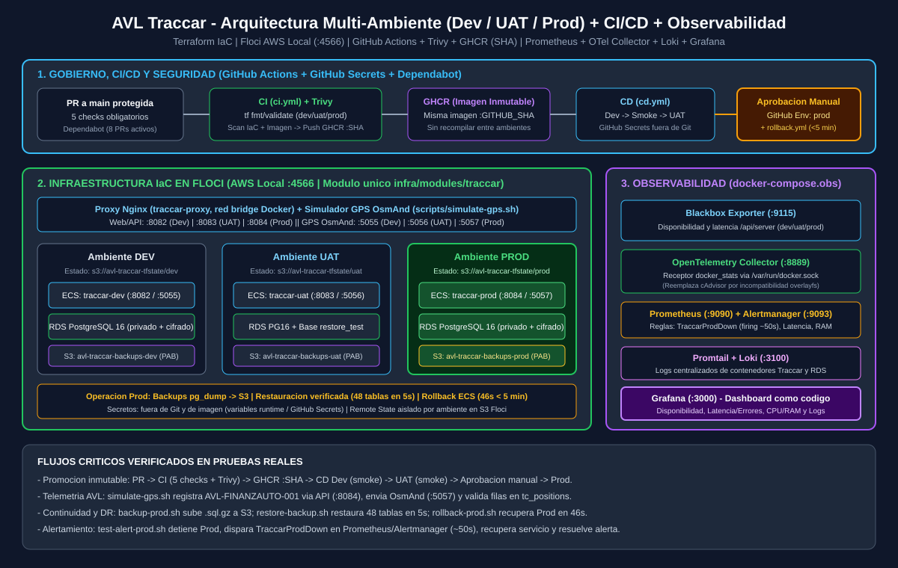

# AVL Traccar - Plataforma DevOps Multi-Ambiente (IaC + CI/CD + Observabilidad)

Plataforma operativa para Traccar AVL con PostgreSQL 16 desplegada mediante un unico modulo de Terraform sobre Floci (emulador AWS local) en tres ambientes aislados (dev, uat, prod), con pipelines CI/CD en GitHub Actions, seguridad con Trivy y Dependabot, backups verificados en S3, rollback de produccion en 46 segundos, observabilidad completa (Prometheus, Alertmanager, Loki, Promtail, OpenTelemetry Collector y Grafana) y simulador GPS OsmAnd.

## Diagrama de Arquitectura

## Prerrequisitos
- Maquina Linux/WSL2 con minimo 8 GB RAM (16 GB recomendados) y 2+ vCPU.
- Docker Engine + Docker Compose v2, Terraform >= 1.6, AWS CLI v2, jq y curl.
- Puertos locales disponibles: 3000, 4566, 5055-5057, 8082-8084, 8889, 9090, 9093, 9115.

## Puertos y Accesos Locales

| Servicio | Ambiente / Rol | URL / Puerto | Notas |
| :--- | :--- | :--- | :--- |
| Traccar Web & API | dev / uat / prod | :8082 / :8083 / :8084 | Credenciales definidas por variables de entorno en runtime |
| OsmAnd GPS | dev / uat / prod | :5055 / :5056 / :5057 | Ingesta HTTP de tramas AVL |
| Floci (AWS local) | Emulador AWS | http://localhost:4566 | ECS, RDS PostgreSQL 16 y S3 emulados |
| Grafana | Dashboards y Logs | http://localhost:3000 | Acceso configurado via variables de entorno locales |
| Prometheus / Alertmanager | Metricas y Alertas | :9090 / :9093 | Reglas en observability/prometheus/alerts.yml |

## Levantar Todo en Pocos Comandos

    # 1. Levantar Floci
    docker compose up -d

    # 2. Aprovisionar ambientes con Terraform (estado separado por ambiente)
    terraform -chdir=infra/envs/dev  init && terraform -chdir=infra/envs/dev  apply -auto-approve
    terraform -chdir=infra/envs/uat  init && terraform -chdir=infra/envs/uat  apply -auto-approve
    terraform -chdir=infra/envs/prod init && terraform -chdir=infra/envs/prod apply -auto-approve

    # 3. Exponer Web/API (8082-8084) y OsmAnd (5055-5057) via proxy Nginx
    ./scripts/expose-envs.sh

    # 4. Levantar stack de observabilidad
    docker compose -f observability/docker-compose.obs.yml up -d

## Desplegar a Cada Ambiente (CI/CD)
1. Abrir un Pull Request hacia main: CI (ci.yml) ejecuta terraform fmt/validate en dev, uat y prod, escanea IaC e imagen con Trivy y bloquea el merge si algo falla.
2. Al fusionar en main, CI construye y publica una unica imagen inmutable en GHCR etiquetada con GITHUB_SHA.
3. CD (cd.yml) promueve esa misma imagen sin recompilar a dev y uat ejecutando smoke-test.sh en cada ambiente, y exige aprobacion manual en GitHub Environments para desplegar en prod.

## Operacion: Smoke Test, GPS, Backup, Restauracion, Rollback y Alerta

    # Prueba de humo por ambiente
    ./scripts/smoke-test.sh http://localhost:8082
    ./scripts/smoke-test.sh http://localhost:8083
    ./scripts/smoke-test.sh http://localhost:8084

    # Simulador GPS OsmAnd (Bonus B1)
    ./scripts/simulate-gps.sh prod AVL-FINANZAUTO-001 5

    # Respaldo de Prod a S3 y restauracion verificada (48 tablas en ~5s)
    ./scripts/backup-prod.sh
    ./scripts/restore-backup.sh

    # Rollback real de Prod en menos de 5 min (medido: 46s)
    ./scripts/rollback-prod.sh
    ./scripts/rollback-prod.sh --image ghcr.io/jparra0715/avl-traccar-devops:<SHA>

    # Prueba controlada de alerta TraccarProdDown (firing -> resolved)
    ./scripts/test-alert-prod.sh

## Que Quedo Pendiente (Alcance Local vs. AWS Productivo)
- Runner self-hosted desde GitHub Actions hacia la maquina local: se omitio por seguridad para no exponer el host personal; el pipeline CD valida la promocion con PostgreSQL 16 + smoke tests en GitHub y los scripts replican la operacion contra Floci.
- Inyeccion nativa del campo secrets de AWS Secrets Manager en task definitions y cifrado KMS CMK en S3 (limitaciones del emulador Floci documentadas en docs/informe.md).
- Terminacion TLS real con ACM/ALB y RDS Multi-AZ (aplicable en cuenta productiva de AWS).

## Documentacion del Proyecto
- Diagrama de Ambientes (SVG): docs/arquitectura-ambientes.svg
- Arquitectura y Decisiones Tecnicas (ADR): docs/ARQUITECTURA.md
- Runbook Operativo: docs/RUNBOOK.md
- Bitacora de Uso de IA: docs/bitacora-ia.md
- Informe de Ejecucion: docs/informe.md
